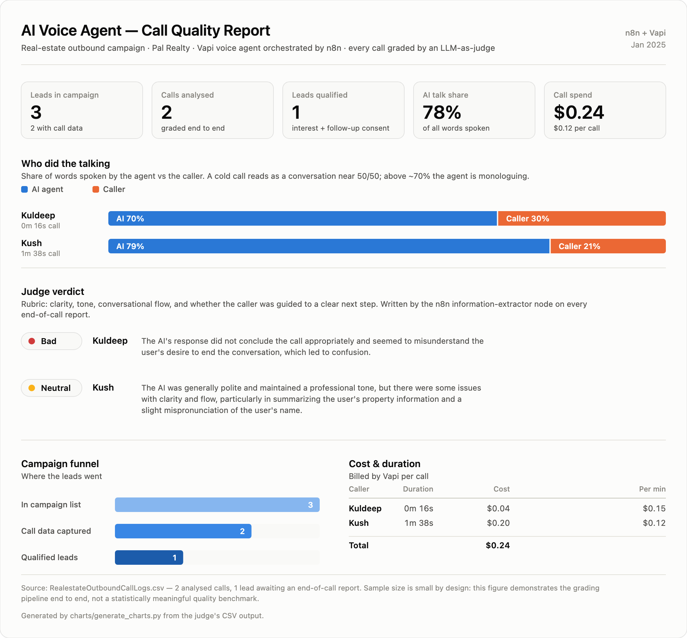
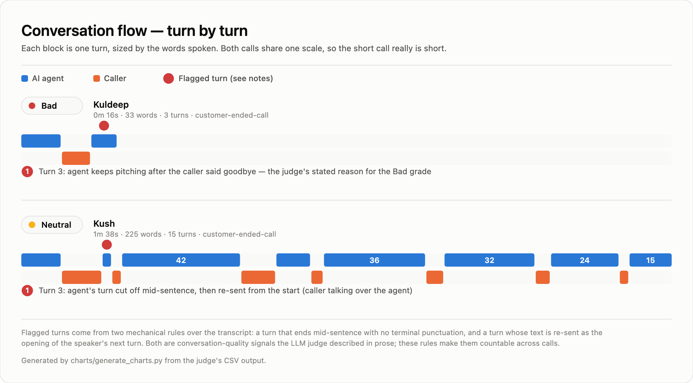
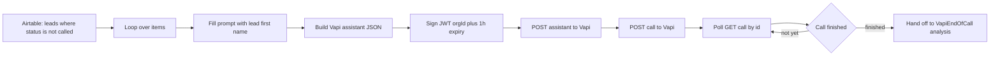
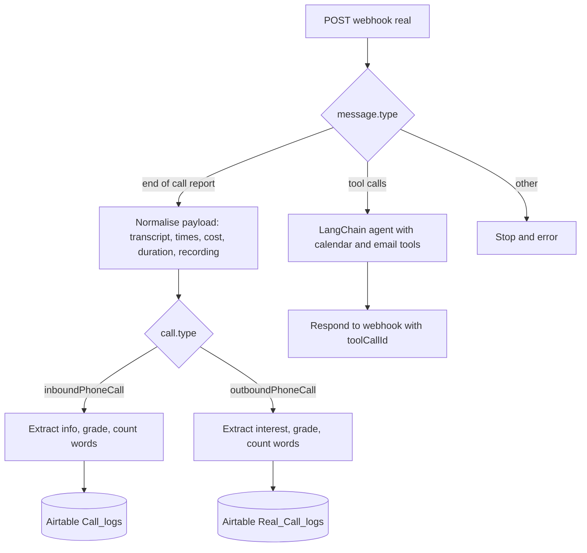
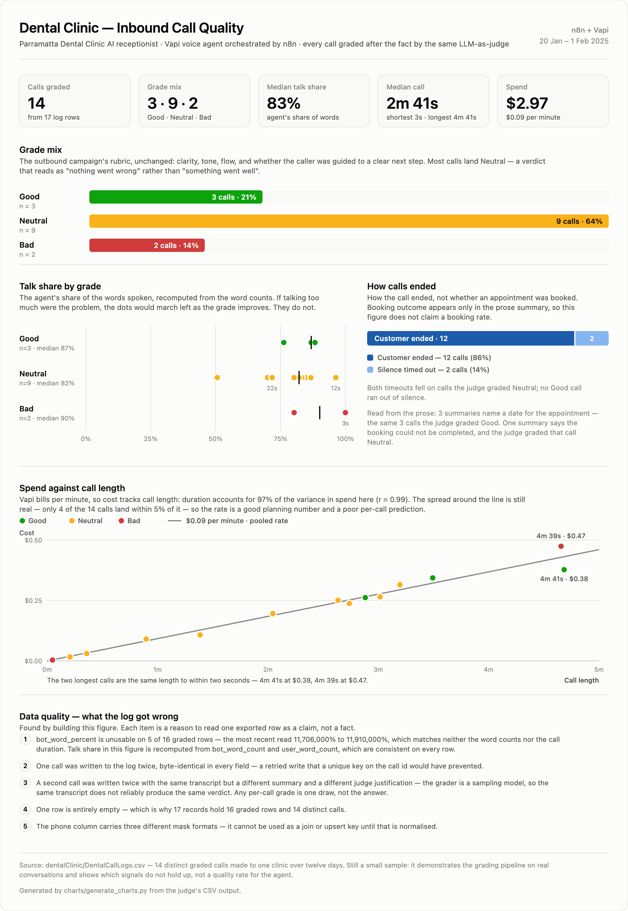

# AI Voice Agents — n8n + Vapi

Two production-shaped AI voice-agent systems built entirely in **n8n workflows**, wired to
**Vapi** for telephony, speech-to-text and text-to-speech, and graded automatically after every
call by an **LLM-as-judge** node.

The point of the project is not just that the agents talk — it is that **every call is
measured**. Each conversation is transcribed, its structured outcome extracted, its quality
graded, and the result written to the CRM, so agent quality is a queryable number instead of a
vibe.

[](charts/call-quality-report.png)

[](charts/conversation-flow.png)

The third figure — the inbound cohort of 14 graded calls, which is the first set here big enough to
test a belief rather than illustrate a pipeline — is embedded in
[What the inbound cohort showed](#what-the-inbound-cohort-showed).

> All three are generated from the judge's own CSV output by
> [`charts/generate_charts.py`](charts/generate_charts.py), which writes them as SVG, and
> [`charts/render_png.py`](charts/render_png.py), which rasterises each one to a 2x PNG for
> embedding here. Re-run both to regenerate them. Click any figure to open it full size.

---

## What's in here

| Path | What it is |
|---|---|
| `realestateOutboundCall/Realestate_Working_Outbound.json` | 53-node n8n workflow: outbound cold-call campaign **and** the Vapi server webhook that handles tool calls and end-of-call reports |
| `realestateOutboundCall/RealestateOutboundCallLogs.csv` | Call log exported from the CRM — one row per call with transcript, extracted fields, cost, duration and the judge's grade |
| `dentalClinic/DentalCallLogs.csv` | 17-row export of the inbound receptionist's calls — the cohort the third figure is built from, and the source of most of the data-quality findings below |
| `dentalClinic/VapiDentalAssistant.json` | 13-node workflow: builds a personalised Vapi assistant per caller, with returning-caller recognition |
| `dentalClinic/VapiDentalTool.json` | 16-node workflow: the agent runtime — Pinecone RAG over clinic documents plus calendar and email tools |
| `dentalClinic/VapiEndOfCall.json` | 20-node workflow: post-call analysis and destruction of the ephemeral Vapi assistant |
| `dentalClinic/taniya_call_edited.MP3` | A real call recording from the dental receptionist (3m 23s, 128 kbps) |
| `charts/generate_charts.py` | Deterministic SVG report generator — reads both call-log CSVs, emits the three figures |
| `charts/render_png.py` | Rasterises each figure to a 2x PNG, cropped exactly to the figure, for embedding in this README |
| `docs/DESIGN-NOTES.md` | Why the figures look the way they do — form choices, the validated palettes, and the layout self-check |
| `tools/redact_call_logs.py` | Masks phone numbers and blanks recording links before a call log is committed |

---

## The two systems

### 1. Real-estate outbound cold-call campaign

An AI agent ("Sarah", Pal Realty) dials a lead list, qualifies interest in selling property,
gathers property details, and books a follow-up — unattended, in batches.

- **Assistant provisioning is just-in-time and per-lead.** Rather than one static Vapi
  assistant, the workflow builds the assistant's full JSON (model, voice, transcriber, tools,
  system prompt) in an n8n `Set` node with the lead's first name interpolated into the prompt,
  then `POST`s it to `api.vapi.ai/assistant`. The returned `assistantId` is used immediately by
  the dial call.
- **Auth is a generated JWT**, not a pasted API key: an n8n `JWT` node signs `{orgId, exp: now + 1h}`
  and the token is passed as a bearer header to the Vapi API.
- **The call is polled to completion** (`GET /call/{id}` in a wait loop) and then handed to the
  analysis pipeline.



### 2. Dental clinic inbound receptionist

Three workflows, split by responsibility so each stays small and independently deployable.

- **`VapiDentalAssistant`** looks the caller's number up in the CRM (`phone = "{number}"`) and
  branches through a chain of `If` nodes on which fields are already known — first name, last
  name, address — to assemble a different prompt for a **returning caller** than for a stranger.
  The greeting adapts; a known patient is not asked who they are.
- **`VapiDentalTool`** is the runtime. A LangChain **Agent** node (system prompt: "Sarah", five
  years at the clinic, answer in 3–7 sentences, always ground dental questions in the knowledge
  base) is wired to:
  - a **Pinecone vector store** (`toolVectorStore`, topK 5) exposed to the model as a
    `Dental_clinic` tool for RAG over clinic documents,
  - **Google Calendar** tools — check availability, schedule appointments, watch events,
  - a **Gmail** tool for confirmations and follow-ups,
  - a **window buffer memory** so the conversation holds context across turns.
- **`VapiEndOfCall`** runs the analysis pipeline (below) and then **deletes the assistant** it was
  created for (`DELETE /assistant/{assistantId}`), so ephemeral per-call assistants never
  accumulate in the Vapi account.

---

## The LLM-as-judge quality system

This is the part that makes the project useful. After every call, Vapi posts an
`end-of-call-report` to the n8n webhook (`POST /webhook/real`). A `Switch` node fans the payload
out by `message.type` into three responsibilities:



### The rubric

Grading runs in a LangChain **Information Extractor** node pointed at the transcript. Its system
prompt, verbatim:

```text
Analyze the interaction in the transcript and grade the AI receptionist's
performance as bad, neutral, or good.

Evaluation Criteria:
1. Clarity: Was the AI easy to understand?
2. Tone: Did the AI sound polite and professional?
3. Flow: Was the conversation smooth, with minimal repetition or confusion?
4. Resolution: Did the AI guide the caller toward a clear next step?

Grading Instructions:
- Grade: Bad, Neutral, or Good
- Justification: 1-2 concise sentences summarizing key reasons for the grade.
```

The node is declared with a typed output schema (`ai_call_performance_grade`,
`ai_performance_justification`), so the model's answer comes back as structured fields the
workflow can branch on — not prose to be parsed.

### Extraction runs alongside grading

The same call is passed through a second extractor that pulls business-relevant fields out of the
conversation. For the outbound campaign that is `Interested_In_Selling`, `property_type`,
`willingness_for_follow-up`, `preferred_time_for_follow_up`, `property_location` and a short
`summary`; the inbound campaign extracts caller identity and the reason for calling. The prompt
specifies defaults (`"Not Provided"`) so the CRM never receives an empty cell.

### Deterministic metrics back the model up

Alongside the LLM's judgement, two JavaScript `Code` nodes compute things a language model should
not be asked to estimate:

- **`Word count`** — splits the transcript on `AI:` / `User:` prefixes and counts words per
  speaker, producing `bot_word_count`, `user_word_count` and `bot_word_percent`. This is the
  talk-ratio metric the figures above are built on.
- **`Format transcript`** — normalises Vapi's single-line transcript into a readable
  turn-per-paragraph form for the CRM and for human review.

The result is a hybrid evaluation: **subjective quality from the LLM, objective shape from
arithmetic.** When they disagree, that disagreement is itself the finding.

---

## What the numbers showed

Three leads sit in the campaign list; two produced complete end-of-call reports. See the first
figure.

| Call | Grade | AI talk share | Duration | Cost | Outcome |
|---|---|---|---|---|---|
| Kuldeep | **Bad** | 70% | 0m 16s | $0.04 | Caller said goodbye immediately |
| Kush | **Neutral** | 79% | 1m 38s | $0.20 | Interest + follow-up consent → qualified lead |

Pooled across both calls the agent spoke **78% of all words** — roughly four words for every one
of the caller's. For a cold call, that is a monologue, and it lines up with the grading:

- The **Bad** call lasted 16 seconds. The caller said *"All good. Thank you very much. Bye bye.
  See you."* and the agent kept pitching. The judge's stated reason was exactly that: *"did not
  conclude the call appropriately and seemed to misunderstand the user's desire to end the
  conversation."*
- The **Neutral** call did produce a qualified lead, but the judge still flagged *"issues with
  clarity and flow, particularly in summarizing the user's property information and a slight
  mispronunciation of the user's name."*

The model's prose verdict and the arithmetic agree, which is the whole reason for computing both.

> **Caveat, added once the inbound cohort landed.** Two calls is not a sample. With 14 graded calls
> in the dental set, talk share stops separating good calls from bad ones — the Bad calls are the
> *most* agent-dominated of the three groups. The monologue reading above is real for these two
> calls and is exactly the kind of tidy story that a bigger dataset is for disproving; see
> [What the inbound cohort showed](#what-the-inbound-cohort-showed).

---

## The defects the instrumentation caught

The second figure turns the transcripts into something countable. Two mechanical rules flag a
turn: it ends mid-sentence with no terminal punctuation, or the speaker's next turn re-sends this
one from the beginning. Applied to the two calls, they found four distinct defects:

| # | Symptom in the transcript | Root cause | Fix |
|---|---|---|---|
| 1 | Caller says *"Bye bye. See you."* — the agent keeps selling | The system prompt's "handle responses thoughtfully" branch has no **exit** path; nothing tells the agent a goodbye ends the call | Add an explicit end-call rule and an `endCall` tool the model can invoke |
| 2 | Agent's turn ends mid-sentence — *"Just to mention, I'm reaching"* | Barge-in: caller speech cut off playback mid-utterance | Tune Vapi's interruption / stop-speaking plan and the agent's turn-taking |
| 3 | Agent's turn restarts from the top — *"That's great to"* → *"That's great to hear, Kush…"* | Same barge-in; the model re-sent its opening instead of continuing | Same, plus prompt guidance on resuming after an interruption |
| 4 | Caller **Kush** greeted as *"Kirsch"*, and the brand *"Pal Realty"* came through as *"Palpeek Realty"* — later turns say "Kush" correctly | The opening line is a fixed template (`Hi {first_name}, this is Sarah calling from Pal Realty…`) rendered by ElevenLabs with no pronunciation guidance, so an unfamiliar name and the brand are both mangled; the transcript then faithfully records the mispronunciation | Add a per-lead pronunciation hint or a pronunciation dictionary on the TTS side, and consider having the agent confirm the name rather than assert it |

One more defect was found by reading the workflow rather than the transcripts: the assistant
template contains **`maxTokens` twice** — `250` and then `90`. JSON object keys must be unique, so
the second silently wins and caps the agent at 90 tokens when the author intended 250. The same
duplicate-key pattern appears as repeated assignments in the `Set` nodes (two identical
`bot_word_count`, two identical `ai_performance_justification` entries) — harmless there because
the values match, but the same class of mistake that *is* harmful when the values differ.
Duplicated keys fail quietly in every JSON parser; it is worth a schema check in CI.

Each of these is the kind of thing that is invisible in a demo and obvious in a dashboard — which
is the argument for building the dashboard first.

---

## What the inbound cohort showed

The dental receptionist log is the first dataset here with enough calls to test a belief instead
of illustrating a pipeline: **14 distinct graded calls** made to one clinic between 20 January and
1 February 2025. The export holds 17 records; one row is empty, one call was written twice, and a
second call was written twice *and* graded twice — see
[What the log got wrong](#what-the-log-got-wrong).

[](charts/inbound-call-quality.png)

### Talk share does not predict quality

The outbound section reads the agent's 78% share of words as monologuing, and monologuing as the
reason for the Bad grade. At two calls that is a story. At fourteen it is not a finding.

| Grade | Calls | Median talk share | Median call | Spend |
|---|---|---|---|---|
| **Good** | 3 | 87% | 3m 30s | $0.98 |
| **Neutral** | 9 | 82% | 2m 03s | $1.51 |
| **Bad** | 2 | 90% | 2m 21s | $0.48 |

The **Bad** calls are the *most* agent-dominated of the three groups, and the Good calls are not
the least. The spread inside a group is wide — Neutral alone runs from 51% to 96%. Whatever
separates a good call from a bad one here, it is not how many words the agent said.

That is the argument for the hybrid evaluation the pipeline already runs. The arithmetic (talk
share, word counts, cost, duration) describes the **shape** of a call, and the judge is the only
component that can say whether the shape did any harm. Neither number is sufficient on its own —
and it is the *disagreement* between them that is worth a dashboard, not either column by itself.
The one signal in this dataset that does track the grade is the business outcome itself, which the
pipeline does not record — see *The rest of what the log records* below.

### What the grade mix says

Nine of fourteen calls are Neutral. The rubric offers three buckets and the judge puts two thirds
of real calls in the middle one — usable for triage, useless as an SLA. It also means "Neutral" is
carrying two different meanings: *nothing went wrong* and *nothing was resolved*. Separating
criteria would separate them.

### The rest of what the log records

- **Cost tracks time.** $2.97 for 32 minutes of talk, a pooled $0.09 a billed minute, and duration
  explains 97% of the variance in spend (r = 0.99). The residual is not noise to ignore: the two
  longest calls are the same length to within two seconds and are $0.09 apart — 4m 39s at $0.47
  for the Bad call against 4m 41s at $0.38 for the Good one, 26% more for the same call length.
- **The caller ends the call 12 times out of 14.** The other two ran out of silence, both on calls
  the judge graded Neutral. No Good call timed out.
- **Booking outcome is not a field — and it is the outcome that matters.** Whether the caller
  actually got an appointment exists only in the prose summary, so this report computes no booking
  rate. Reading all fourteen summaries is still worth it, because the outcome there lines up with
  the grade where talk share does not:
  - **3** record an appointment as *made* or *scheduled* on a named date — and they are **exactly**
    the three calls the judge graded Good.
  - **1** names a requested slot ("an appointment for tomorrow at 5:30 PM") without confirming it;
    graded Neutral.
  - **1** says the booking **could not be completed** — the agent's core job, attempted and failed —
    and the judge graded that call Neutral as well.
  - The remaining **9** record a request with no slot, or no booking at all; two of those summaries
    are empty.

  Three calls agreeing with a grade is a hypothesis, not a result. But it is a better hypothesis
  than talk share, and it is invisible to the pipeline purely because nobody made it a column —
  which is why recording the outcome as a structured field is roadmap item 3.

### What the log got wrong

Building the figure surfaced five defects in the export itself. They are listed on the figure, and
they are worth more than the chart:

| # | Defect | Effect |
|---|---|---|
| 1 | `bot_word_percent` reads 11,706,000% – 11,910,000% on the five **earliest** rows (20–25 Jan) and a correct whole percentage on the eleven graded rows after — neither value derivable from the word counts or the duration | The stored metric is unusable, so talk share is recomputed from the word counts. A derived field nothing validates drifts from its own inputs |
| 2 | One call written to the log twice, byte-identical in every field | Any naive count double-counts the call. A unique key on the Vapi call id prevents it |
| 3 | A second call written twice with the same transcript but a different `summary` **and a different judge justification** | The grader is a sampling model: the same transcript does not reliably produce the same verdict, so a per-call grade is one draw, not the answer |
| 4 | One row entirely empty | 17 records → 16 graded rows → 14 distinct calls. Every count in this README has to say which denominator it means |
| 5 | The `phone` column carries three different mask formats | It cannot be used as a join key until it is normalised — which matters, because the outbound campaign upserts on exactly that column |

Defect 3 is the one that changes how the grade should be treated. The workflow asks a sampling
model for a verdict once and writes it to the CRM as if it were a measurement. It is a sample.
Grading each call several times and storing the modal verdict plus the spread — or fixing a seed
and a low temperature — would make the column reproducible, and until then it should not drive an
alert threshold.

Defect 1 is the one with a fix in this repo. The `Code` node computed the talk share correctly and
then returned it **as a string with a `%` suffix** — `"83%"` — which the `Set` nodes passed along
as a string and the Airtable node handed to a **Percent** field. Airtable's typecast parses `"83%"`
back into `0.83`, the fraction that field stores, which is why eleven rows read correctly: the
value survived by coercion at the destination rather than by being right. That is one field-type
change away from writing a number six orders of magnitude out, so the fix removes the coercion
entirely:

- the node returns **plain numbers** — integers for the counts, `0–100` for the two shares
- the caller's share is the exact complement of the agent's, so the pair sums to 100 instead of
  rounding independently to 99 or 101
- a segment with no words counts as zero words, not one — `"".split(/\s+/)` returns `[""]`, so a
  bare `AI:` line used to be counted as a word spoken
- the `Set` nodes declare the shares as numbers, and the Airtable mapping does the single explicit
  conversion to the fraction a Percent field stores, with a note on the node recording why

The column type is the one thing here that cannot be read out of this repo, so the note names the
alternative: if `bot_word_percent` is a Number field rather than a Percent field, bind
`$json.bot_word_percent` directly. The five historical rows are left as they were found — recomputing
them from the word counts they already carry is roadmap item 4's job.

---

## Data model

The campaign's CRM row is the CSV in this repo. One row per call:

| Group | Columns |
|---|---|
| Identity | `first_name`, `last_name`, `phone` |
| Campaign state | `status`, `call_type`, `ended_reason` |
| Extracted by LLM | `Interested_In_Selling`, `property_type`, `wilingness_for_follow-up`, `preferred_time_for_follow_up`, `property_location`, `query`, `summary` |
| Call facts from Vapi | `started_at`, `ended_at`, `recording_url`, `call_duration`, `call_cost` |
| Computed in n8n | `bot_word_count`, `bot_word_percent`, `user_word_count` |
| Judge output | `ai_call_performance_grade`, `ai_performance_justification` |
| Evidence | `formatted_transcript` |

Writes are **upserts keyed on `phone`**, so a redial updates the existing lead record instead of
creating a duplicate — an important property when the campaign loop retries numbers.

> The sample data committed here has the `phone` column masked and `recording_url` blanked, because
> Vapi recording links are typically unauthenticated — anyone holding one can listen to the call.
> Everything the report is built from (names, transcripts, grades, costs, word counts) is
> untouched. See [`tools/redact_call_logs.py`](tools/redact_call_logs.py).

> `wilingness_for_follow-up` is spelled that way in the Airtable base; the workflow maps it to the
> correctly-spelled `willingness_for_follow-up` the extractor emits. Worth fixing at the source.

---

## Setup

### Import the workflows

```bash
# In n8n: Workflows → Import from File
realestateOutboundCall/Realestate_Working_Outbound.json
dentalClinic/VapiDentalAssistant.json
dentalClinic/VapiDentalTool.json
dentalClinic/VapiEndOfCall.json
```

The four workflows are **co-dependent**, not standalone:

```
VapiDentalAssistant       ──executeWorkflow──▶ supplies the personalised prompt
VapiDentalTool            ──executeWorkflow──▶ the agent runtime
VapiEndOfCall             ──executeWorkflow──▶ post-call analysis + assistant cleanup
Realestate_Working_Outbound ──executeWorkflow──▶ VapiEndOfCall
```

The outbound workflow's dial loop polls until the call ends, then **hands the finished call to
`VapiEndOfCall`** — the same analysis workflow the dental project uses. The outbound workflow also
carries its own copy of that analysis branch, which is what serves calls that arrive as a Vapi
webhook rather than from the dial loop. That duplication is deliberate (the two entry points must
not block each other) but it is duplication, and consolidating it is on the roadmap.

Import them all, then re-point every `Execute Workflow` and `Tool` node at the imported copies —
n8n stores workflow references by ID, so IDs from another instance will not resolve. The
`Realestate_Working_Outbound` dial loop in particular will need its `Execute Workflow` node
re-pointed at your imported `VapiEndOfCall`.

### Credentials to configure

| Credential | Used by |
|---|---|
| Airtable personal access token | lead source and both call-log tables |
| OpenAI API key | Vapi's model, every extractor and grader node, embeddings |
| Pinecone API key | the dental knowledge base |
| Google Calendar OAuth2 | availability checks and appointment booking |
| Gmail OAuth2 | confirmations and follow-ups |
| Vapi API key | `POST /assistant`, `POST /call`, `GET /call/{id}`, `DELETE /assistant/{id}` |
| JWT signing secret | signs the Vapi bearer token |

### Values you must replace after import

These are instance-specific and are **not** portable between n8n installations:

- the Vapi **server URL** in the assistant template (point it at *your* n8n webhook host),
- the Vapi **`phoneNumberId`** used for dialling,
- the Airtable **base and table IDs**,
- the JWT **`orgId`** claim and its signing secret.

---

## Security notes

- **API keys never touch the front end.** Every LLM, calendar, email and telephony call is made
  server-side by n8n; the browser only sees the chat widget's own endpoint. The Vapi bearer token
  is *generated per request* by an n8n JWT node from a stored credential and expires in an hour —
  it is never a long-lived secret sitting in a config file.
- **Ephemeral assistants are cleaned up.** `VapiEndOfCall` deletes the assistant it created, so
  test and production assistants do not pile up in the account.
- **`Stop and Error` on unexpected payloads.** The webhook's `Switch` node routes anything that is
  neither an end-of-call report nor a tool call to a hard failure, so a malformed or spoofed
  payload cannot silently fall through into the CRM.
- Use n8n credentials for every secret. Do not inline keys into node parameters — workflow JSON
  files get committed, credentials do not.

## Known limitations

- **Two cohorts, both small.** The outbound set is two graded calls; the inbound set is fourteen,
  at one clinic, over twelve days, against one agent configuration. Fourteen calls are enough to
  show a signal *failing* to hold; they are not enough to estimate a quality rate. Both figures say
  so on their face rather than in a footnote.
- **The judge is a sample, not a measurement.** One call in the inbound log was graded twice from
  the same transcript and came back Neutral both times with different justifications. It should be
  validated against hand-labelled calls and made reproducible before it drives any threshold.
- **One grade per call, no per-criterion scores.** The rubric names four criteria and returns one
  verdict. At fourteen calls, two thirds landed Neutral — a bucket that cannot distinguish
  "nothing went wrong" from "nothing was resolved". Returning a score per criterion is the
  highest-value next change; it would make the report diagnostic rather than descriptive.
- **The business outcome is not recorded anywhere.** Whether the caller actually got an
  appointment exists only in the prose summary the extractor happens to write.
- **The CRM holds a derived field that disagrees with its own inputs.** `bot_word_percent` is
  wrong on the five earliest rows of the inbound table. The computation that produced it is fixed
  (see [What the log got wrong](#what-the-log-got-wrong)), but the historical rows are not, the
  `phone` column still carries three mask formats, and nothing in the pipeline validates either.
- **Names are transcribed, not confirmed.** Defect 4 above is a symptom of that.
- The `Code` nodes assume Vapi's `AI:` / `User:` transcript format. A change in that format fails
  quietly to zero word counts.

## Roadmap

1. Per-criterion judge output (clarity / tone / flow / resolution scored separately) and a
   threshold that raises an alert when a call drops below it.
2. **Judge reproducibility, then agreement with humans.** Grade each call N times and store the
   modal verdict *and* the spread; pin a seed and a low temperature; then score the judge against a
   hand-labelled set. Until a transcript grades the same way twice, a quality SLA built on it is
   measuring the sampler.
3. **Booking outcome as a structured field.** Have the agent's calendar tool write the outcome
   (booked / declined / no slot / abandoned) back to the CRM, instead of leaving it in prose — and
   alert on `silence-timed-out`, which is a call the agent failed to steer.
4. A CI check on both the workflow JSON and the exported logs: schema validation, unique JSON keys,
   no inlined secrets, a unique key on the Vapi call id so a retried webhook cannot double-write,
   one phone format, and derived fields that agree with their inputs.
5. Auto-redial of `ended_reason = customer-ended-call` leads at a different time of day, with the
   attempt history kept on the lead row.
6. Move the reporting step into a scheduled n8n workflow so the quality report is refreshed
   automatically instead of being generated by hand.
